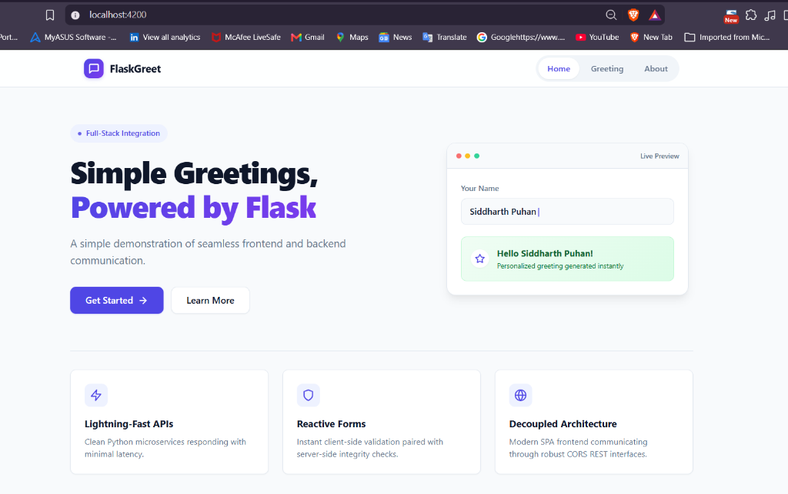
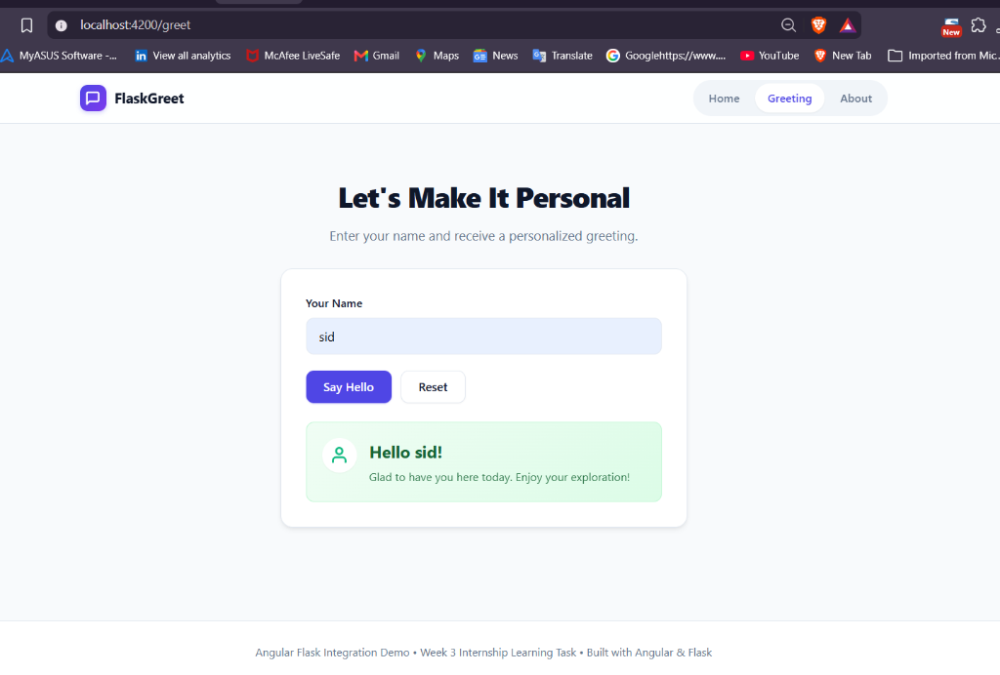
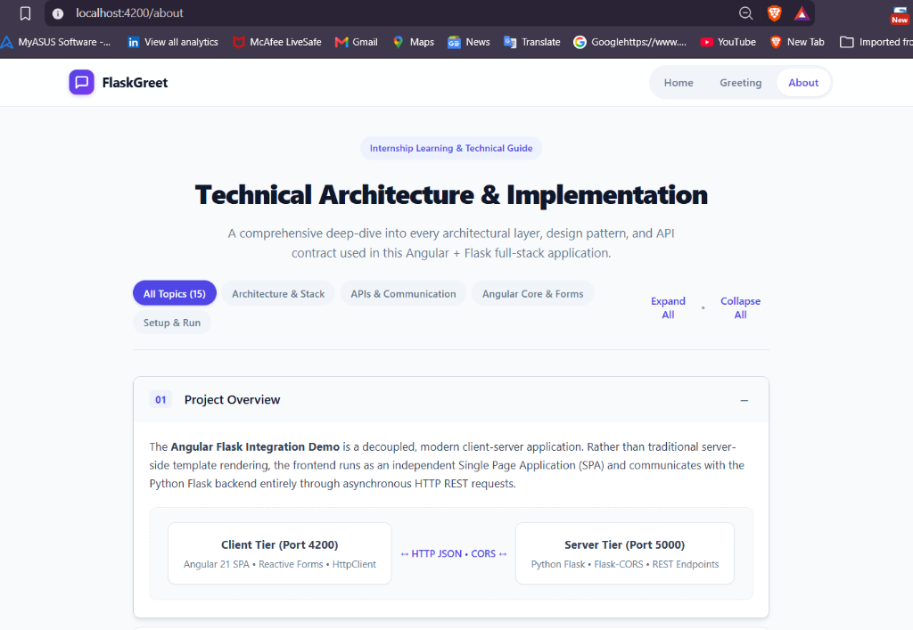
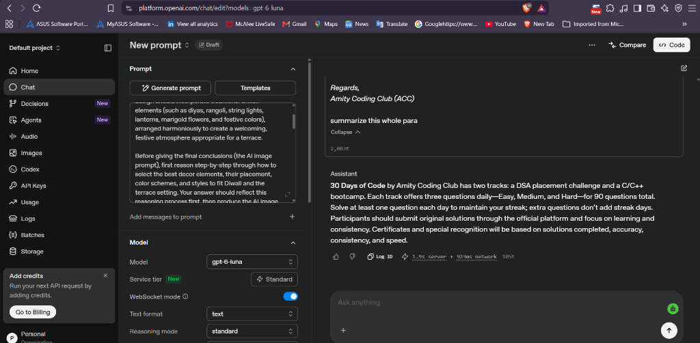

# Angular + Flask Integration Demo

> **Week 3 Internship Practical Implementation Project**  
> A complete, fully functional end-to-end web application demonstrating Flask REST APIs, JavaScript `fetch()` integration, Angular standalone architecture, Angular Reactive Forms, dependency-injected HTTP services, CORS handling, and prompt engineering fundamentals.

---

## 1. Project Overview & Architecture

This repository contains a full-stack integration project built to demonstrate Week 3 learning objectives.

```
┌────────────────────────────────────────────────────────────────────────┐
│                              CLIENT TIER                               │
│                                                                        │
│   ┌────────────────────────────────┐    ┌───────────────────────────┐  │
│   │       Angular Application      │    │      JavaScript Demo      │  │
│   │     (http://localhost:4200)    │    │      (Direct fetch)       │  │
│   │                                │    │                           │  │
│   │  • HomeComponent (Landing)     │    │  • GET  /health           │  │
│   │  • GreetingComponent (Forms)   │    │  • GET  /hello            │  │
│   │  • AboutComponent (Doc Center) │    │  • POST /greet            │  │
│   │  • ApiService (HttpClient)     │    │  • Loading / Error States │  │
│   └────────────────┬───────────────┘    └─────────────┬─────────────┘  │
└────────────────────┼──────────────────────────────────┼────────────────┘
                     │                                  │
           HTTP JSON │ (CORS: localhost:4200)           │ HTTP JSON
                     ▼                                  ▼
┌────────────────────────────────────────────────────────────────────────┐
│                              SERVER TIER                               │
│                                                                        │
│                    Flask REST API (http://127.0.0.1:5000)              │
│                    ├── Flask-CORS Integration                          │
│                    ├── GET  /health (Uptime & Server Time)             │
│                    ├── GET  /hello  (Static JSON Response)             │
│                    └── POST /greet  (Validation & Greeting)            │
└────────────────────────────────────────────────────────────────────────┘
```

---

## 2. Application Preview & Screenshots

The application features a modern SaaS-inspired user interface built with Angular standalone components and responsive design tokens.

### Home Page (`/`)
A minimal, elegant landing page introducing the project with call-to-actions, value pillars, and a simulated interaction preview card.



---

### Greeting Page (`/greet`)
An interactive greeting interface powered by Angular Reactive Forms. It validates user input, sends an asynchronous `POST` request to Flask, and displays the personalized server response.



---

### Technical Documentation & Architecture Page (`/about`)
A centralized technical guide organizing all 15 educational topics into an interactive accordion with category filter pills and global expand/collapse controls.



---

### OpenAI Playground: Prompt Engineering Experiment
Demonstrates a hands-on prompt engineering experiment conducted in the OpenAI Playground. A comprehensive informational paragraph regarding the "30 Days of Code by Amity Coding Club" challenge was provided and the model was asked to summarize it (`"summarize this whole para"`), demonstrating zero-shot extraction and dense summarization.



---

## 3. Technology Stack

### Frontend
- **Framework:** Angular (v21)
- **Language:** TypeScript
- **Architecture:** Standalone Components (`HomeComponent`, `GreetingComponent`, `AboutComponent`, `NavbarComponent`)
- **Forms:** Angular Reactive Forms (`FormGroup`, `FormControl`, `Validators`)
- **HTTP Client:** Angular `HttpClient` + RxJS Observables
- **Styling:** Modern CSS3 Flexbox & Grid with design variables

### Backend
- **Framework:** Python Flask (v3.1.3)
- **CORS Middleware:** `flask-cors` (v6.0.5)
- **Data Exchange:** REST APIs with structured JSON payloads
- **Validation:** Server-side request inspection, whitespace trimming, and HTTP 400 bad request handling

### Independent Demos & Documentation
- **Direct JavaScript Demo:** Vanilla HTML5, CSS3, and JavaScript `fetch()` API
- **Prompt Engineering:** Playground fundamentals, zero-shot vs few-shot prompting, and experiment logging template
- **Learning Guide:** Comprehensive explanations in [`LEARNING_GUIDE.md`](./LEARNING_GUIDE.md)

---

## 4. Repository Structure

```text
week-3-task/
├── backend/
│   ├── app.py              # Flask backend implementation & REST endpoints
│   ├── requirements.txt    # Python dependencies (flask, flask-cors)
│   ├── test_app.py         # 11 unit tests for Flask endpoints & validation
│   ├── live_verify.py      # Live loopback integration test runner
│   └── README.md           # Backend setup & API reference
│
├── frontend/
│   ├── src/
│   │   ├── app/
│   │   │   ├── components/ # Standalone components (home, greeting, about, navbar)
│   │   │   ├── models/     # TypeScript interfaces for request/response payloads
│   │   │   ├── services/   # ApiService for centralized HTTP communication
│   │   │   ├── app.config.ts # Router & provideHttpClient configuration
│   │   │   ├── app.routes.ts # Client-side routing table
│   │   │   └── app.ts      # Root component
│   │   ├── environments/   # Base API URL configuration
│   │   └── styles.css      # Design tokens and common styles
│   ├── angular.json        # Angular CLI configuration
│   ├── package.json        # Frontend dependencies & npm scripts
│   └── README.md           # Frontend setup & build guide
│
├── javascript-demo/
│   ├── index.html          # Clean UI demonstrating native fetch()
│   ├── script.js           # Vanilla JS fetch() logic with async/await
│   ├── style.css           # Responsive demo styles
│   └── README.md           # JavaScript demo guide
│
├── prompt-engineering/
│   ├── playground-experiment.png # Actual OpenAI Playground summarization experiment
│   └── README.md           # Prompt engineering guide & experiment template
│
├── screenshots/
│   ├── home-page.png       # Screenshot of the Home landing page
│   ├── greeting-page.png   # Screenshot of the Greeting form submission
│   ├── about-page.png      # Screenshot of the Technical Architecture page
│   ├── playground-experiment.png # Screenshot of the Playground experiment
│   └── README.md           # Screenshots documentation
│
├── LEARNING_GUIDE.md       # In-depth architectural & conceptual guide
└── README.md               # Root project documentation
```

---

## 5. Setup and Execution Instructions

### Step 1: Run the Flask Backend

1. Open a terminal in the `backend/` directory:
   ```bash
   cd backend
   ```
2. Install Python dependencies:
   ```bash
   pip install -r requirements.txt
   ```
3. Start the Flask server:
   ```bash
   python app.py
   ```
   The backend will be running at:
   ```text
   http://127.0.0.1:5000
   ```

---

### Step 2: Run the Angular Frontend

1. Open a second terminal in the `frontend/` directory:
   ```bash
   cd frontend
   ```
2. Install Node dependencies (if not already installed):
   ```bash
   npm install
   ```
3. Start the Angular development server:
   ```bash
   npm start
   ```
4. Open your browser and navigate to:
   ```text
   http://localhost:4200
   ```

---

### Step 3: Run the JavaScript Integration Demo

1. With the Flask backend running, navigate to `javascript-demo/`.
2. Double-click `index.html` to open it in your web browser, or serve it using Python:
   ```bash
   cd javascript-demo
   python -m http.server 8000
   ```
   Then open `http://localhost:8000` in your browser.

---

## 6. API Endpoints Reference

| Method | Endpoint | Request Body | Success Response | Error Response | Description |
| :--- | :--- | :--- | :--- | :--- | :--- |
| `GET` | `/health` | *None* | `200 OK`<br>`{"status": "healthy", "service": "Flask Backend", "uptime_seconds": 12.34}` | *None* | Backend health & uptime check |
| `GET` | `/hello` | *None* | `200 OK`<br>`{"message": "Hello from Flask"}` | *None* | Simple welcoming greeting |
| `POST` | `/greet` | `{"name": "Siddharth"}` | `200 OK`<br>`{"message": "Hello Siddharth", "timestamp": "..."}` | `400 Bad Request`<br>`{"error": "Name cannot be empty..."}` | Personalized greeting with validation |

### Sample cURL Commands

```bash
# 1. Ping Health
curl http://127.0.0.1:5000/health

# 2. Get Hello
curl http://127.0.0.1:5000/hello

# 3. Post Greeting (Valid)
curl -X POST http://127.0.0.1:5000/greet -H "Content-Type: application/json" -d "{\"name\": \"Siddharth\"}"

# 4. Post Greeting (Invalid - Returns HTTP 400)
curl -X POST http://127.0.0.1:5000/greet -H "Content-Type: application/json" -d "{\"name\": \"\"}"
```

---

## 7. Testing & Verification Summary

All verification tests have been actively executed and confirmed passing:

1. **Backend Unit Tests:**
   - Ran `backend/test_app.py` covering root endpoint, `/health`, `/hello`, `/greet` valid names, whitespace trimming, empty strings, missing fields, non-string types, 404 handler, and CORS headers.
   - **Result:** `Ran 11 tests in 0.038s — OK`.
2. **Live Loopback Network Test:**
   - Executed `backend/live_verify.py` which bound the Flask server to `http://127.0.0.1:5000` and performed live socket HTTP requests over loopback.
   - **Result:** `ALL 5 LIVE HTTP INTEGRATION TESTS PASSED SUCCESSFULLY!`.
3. **Angular Frontend Compilation:**
   - Executed `npm run build` inside `frontend/`.
   - **Result:** `Application bundle generation complete` with 0 errors and 0 warnings.

---

## 8. Internship Concepts Covered

Detailed write-ups and explanations are available in [`LEARNING_GUIDE.md`](./LEARNING_GUIDE.md):
- **CORS Mechanics:** Preflight `OPTIONS` requests, `Access-Control-Allow-Origin` headers, and why browsers enforce SOP.
- **Angular Architecture:** Standalone components, dependency injection, and singleton services.
- **Reactive Forms:** `FormGroup`, `FormControl`, synchronous validation vs template-driven approaches.
- **HTTP Communication:** Promises (`fetch`) vs. RxJS Observables (`HttpClient`).
- **Prompt Engineering:** System instructions, zero-shot vs few-shot paradigms, and OpenAI Playground parameter configuration.
