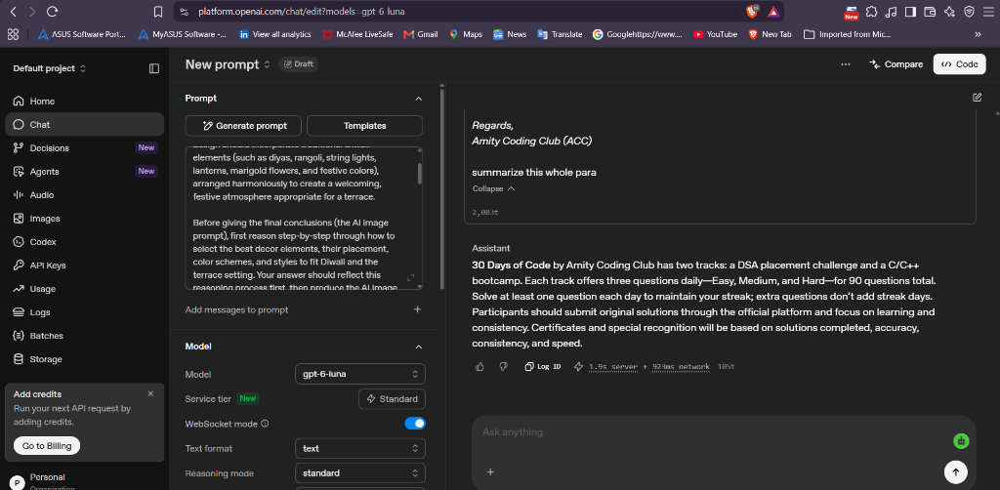

# Prompt Engineering Experiments & Learning Guide

## 1. What is Prompt Engineering?

**Prompt Engineering** is the practice and methodology of structuring, formulating, and refining inputs (prompts) given to Large Language Models (LLMs) to reliably guide them toward producing accurate, relevant, high-quality, and deterministic outputs.

Because modern LLMs (such as GPT-4o, Claude 3.5 Sonnet, or Gemini 1.5 Pro) are probabilistic next-token predictors trained on vast corpora of text, the clarity, context, constraints, and structure of the input prompt directly govern the quality of the completion. Rather than viewing an AI as a search engine, prompt engineering treats the model as a programmable reasoning engine where natural language is the interface.

---

## 2. What is the OpenAI Playground?

The **OpenAI Playground** (`https://platform.openai.com/playground`) is a web-based developer sandbox designed for testing, prototyping, and benchmarking prompts across different model architectures and parameter configurations before writing production code.

### Key Playground Controls & Parameters

| Parameter | Range | Description & Best Practice |
| :--- | :--- | :--- |
| **Model** | e.g. `gpt-4o`, `gpt-4o-mini`, `gpt-6-luna` | Selects the foundational LLM architecture based on speed, cost, and reasoning capability. |
| **System Instructions** | Freeform text | Persistent rules and role definitions that constrain the assistant across all conversational turns. |
| **Temperature** | `0.0` to `2.0` | Controls randomness. Lower values (`0.0` to `0.2`) produce deterministic, focused responses (ideal for coding, JSON extraction, and math). Higher values (`0.7` to `1.0`) introduce creative variety (ideal for brainstorming). |
| **Top P** (Nucleus Sampling) | `0.0` to `1.0` | Alternative to temperature; considers only the tokens comprising the top $P$ probability mass. Standard recommendation: adjust either Temperature OR Top P, never both. |
| **Max Tokens** | Integer (e.g. `2048`) | Upper bound on generated completion tokens to prevent runaway generation and manage API costs. |
| **Stop Sequences** | Array of strings | Specific tokens (e.g., `###`, `END`) that immediately halt model generation when encountered. |

---

## 3. How System and User Prompts Work

Modern conversational models structure the context window into distinct participant roles:

```text
┌─────────────────────────────────────────────────────────────┐
│                       SYSTEM PROMPT                         │
│  "You are an expert full-stack TypeScript/Python mentor.    │
│   Always output valid JSON without conversational filler."  │
└──────────────────────────────┬──────────────────────────────┘
                               │ (Constrains behavior)
                               ▼
┌─────────────────────────────────────────────────────────────┐
│                        USER PROMPT                          │
│  "Validate this user object: { name: 'Siddharth' }"         │
└──────────────────────────────┬──────────────────────────────┘
                               │ (Generates output)
                               ▼
┌─────────────────────────────────────────────────────────────┐
│                      ASSISTANT RESPONSE                     │
│  { "valid": true, "sanitized_name": "Siddharth" }           │
└─────────────────────────────────────────────────────────────┘
```

1. **System Prompt (Developer / Meta-instruction):**
   - Sets the global persona, tone, strict operational constraints, output formats, and safety boundaries.
   - Has higher adherence priority and remains persistent across multiple conversational turns.
2. **User Prompt:**
   - The immediate task, question, or payload provided during runtime.
3. **Assistant Prompt:**
   - The historical output generated by the LLM in multi-turn dialogues.

---

## 4. Prompting Paradigms: Zero-Shot vs. Few-Shot

### A. Zero-Shot Prompting
Zero-shot prompting presents a task to the model **without providing any prior demonstrations or examples**. The model must rely entirely on its pre-trained knowledge and reasoning capabilities.

*Best for:* Well-defined, standardized tasks such as basic translation, summarization, or common coding syntax.

### B. Few-Shot Prompting (In-Context Learning)
Few-shot prompting provides the model with **one or more exemplary input-output pairs** inside the prompt context before presenting the actual query.

*Best for:* Custom output formats, domain-specific classifications, structured JSON schemas, or subtle stylistic consistency.

---

## 5. Effective Prompting Techniques

1. **Role and Persona Assignment:**
   *Example:* "Act as a Senior Application Security Architect reviewing Flask API endpoints."
2. **Clear Delimiters:**
   Use triple backticks (```` ``` ````), XML tags (`<context>...</context>`), or markdown headers to prevent prompt injection and clearly separate instructions from user input.
3. **Structured Output Enforcement:**
   Explicitly instruct the model to return `JSON`, `YAML`, or a strict schema, and state: *"Do not output conversational introductory phrases like 'Sure, here is your answer:'"*.
4. **Step-by-Step Chain-of-Thought (CoT):**
   Instruct the model to think step-by-step: *"First, list edge cases. Second, check boundary conditions. Third, write the implementation."*
5. **Negative Constraints:**
   Explicitly state what **NOT** to do (e.g., *"Do not use deprecated Angular module patterns; use standalone components only"*).

---

## 6. Illustrative Prompt Comparisons

> *Note: The following examples are illustrative scenarios curated for full-stack and API development demonstrations.*

### Comparison 1: Weak Prompt vs. Improved Prompt

#### ❌ Weak Prompt
```text
Make an API in flask that takes a name and says hello.
```

**Why it fails or produces fragile code:**
- No specification of HTTP methods (`GET` vs `POST`).
- No definition of request body format (JSON vs form data vs query parameters).
- Ignores input validation (empty strings, missing keys, numbers).
- Omits CORS handling for frontend origins.
- Does not specify error codes (e.g., HTTP 400 Bad Request vs 200 OK).

####  Improved Prompt
```text
Role: Senior Python Web Services Developer.
Task: Write a production-grade Flask REST API endpoint for greeting users.

Technical Requirements:
1. Route: POST /greet
2. Request Payload: JSON object with the schema: {"name": string}
3. Validation Rules:
   - Verify Content-Type is 'application/json'.
   - Verify 'name' key exists and is of string type.
   - Trim whitespace; if empty, return HTTP 400 with {"error": "Name is required"}.
4. Success Response: HTTP 200 with {"message": "Hello <name>", "timestamp": "<ISO 8601 UTC>"}.
5. Security: Enable CORS to permit requests from http://localhost:4200.
6. Constraints: Return only clean Python code with inline docstrings. Avoid conversational text.
```

---

### Comparison 2: Illustrative Zero-Shot Example

#### System Prompt:
```text
You are an API error code auditor. Given a scenario, output the most accurate RFC 9110 HTTP status code and a concise rationale.
```

#### User Prompt (Zero-Shot):
```text
Scenario: A client submits a POST request to /greet with a valid JSON body {"name": "Siddharth"}, but the server is under scheduled maintenance and cannot process requests right now.
```

#### Expected Illustrative Model Output:
```json
{
  "status_code": 503,
  "status_text": "Service Unavailable",
  "recommended_header": "Retry-After: 300",
  "rationale": "HTTP 503 indicates that the server is currently unable to handle the request due to temporary overload or scheduled maintenance, which is expected to be alleviated after some delay."
}
```

---

### Comparison 3: Illustrative Few-Shot Example

#### System Prompt:
```text
You are a data validation classifier for an Angular + Flask registration pipeline. 
Analyze incoming user inputs and return a structured JSON response specifying status and error codes.
```

#### User Prompt (Few-Shot Demonstrations + Test Case):
```text
Input: "   "
Output:
{
  "valid": false,
  "code": "EMPTY_INPUT",
  "message": "Input contains only whitespace characters."
}

Input: "Siddharth"
Output:
{
  "valid": true,
  "code": "OK",
  "sanitized": "Siddharth"
}

Input: "A very long name that exceeds fifty characters limit 12345678901234567890"
Output:
{
  "valid": false,
  "code": "MAX_LENGTH_EXCEEDED",
  "message": "Input length 66 exceeds allowed maximum of 50 characters."
}

Input: ""
Output:
```

#### Expected Illustrative Model Output:
```json
{
  "valid": false,
  "code": "EMPTY_INPUT",
  "message": "Input string is empty."
}
```

---

## 7. Actual OpenAI Playground Experiment: Paragraph Summarization

Below is an actual hands-on experiment conducted in the **OpenAI Playground** (`platform.openai.com`), testing text summarization with direct natural language prompting:



### Experiment Details

- **Platform:** OpenAI Playground (`platform.openai.com/chat/edit`)
- **Model:** `gpt-6-luna`
- **Configuration:** Service tier: Standard &bull; Text format &bull; Standard reasoning mode
- **Task Description:** Provided a detailed descriptive paragraph describing the "30 Days of Code by Amity Coding Club (ACC)" challenge, rules, tracks, submission guidelines, and certification criteria, and asked the model to summarize it.
- **User Prompt:**
  ```text
  [...full paragraph provided...]
  Regards,
  Amity Coding Club (ACC)

  summarize this whole para
  ```
- **Observed Assistant Output:**
  > *"30 Days of Code by Amity Coding Club has two tracks: a DSA placement challenge and a C/C++ bootcamp. Each track offers three questions daily—Easy, Medium, and Hard—for 90 questions total. Solve at least one question each day to maintain your streak; extra questions don't add streak days. Participants should submit original solutions through the official platform and focus on learning and consistency. Certificates and special recognition will be based on solutions completed, accuracy, consistency, and speed."*
- **Execution Performance:**
  - **Latency:** 1.9s server execution + 923ms network transmission
  - **Tokens Generated:** 105 tokens
- **Key Takeaway:**
  Zero-shot instructional summarization prompts ("summarize this whole para") allow large language models to accurately extract core facts, rules, and milestones from unstructured text without altering technical requirements.

---

## 8. Hands-on Experiment Results Template

Use the structured template below to record further prompts tested in the OpenAI Playground or your preferred LLM interface:

```markdown
### Experiment Log #1: API Endpoint Generation

- **Date:** [YYYY-MM-DD]
- **Tester:** Siddharth Puhan
- **Platform:** OpenAI Playground / ChatGPT / Claude
- **Model Selected:** gpt-4o / gpt-6-luna (or specify)
- **Temperature:** 0.2
- **Top P:** 1.0

#### System Prompt:
> [Enter your system prompt here]

#### User Prompt:
> [Enter your user prompt here]

#### Observed Model Output:
```text
[Paste the raw response generated by the model]
```

#### Qualitative Evaluation:
1. **Adherence to Constraints (1-5):** [Rating]
2. **Correctness of Output:** [Did it handle validation, status codes, and formatting accurately?]
3. **Unexpected Behaviors:** [Any hallucinations, unwanted conversational markdown, or syntax bugs?]
4. **Follow-up Refinements:** [What single prompt change improved the output?]
```
