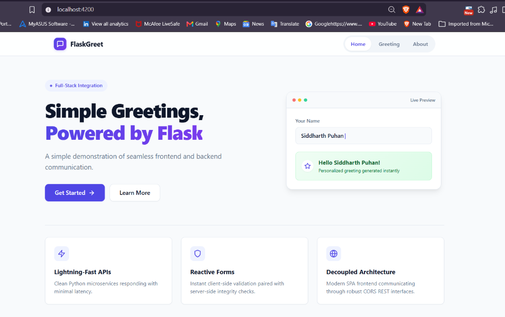
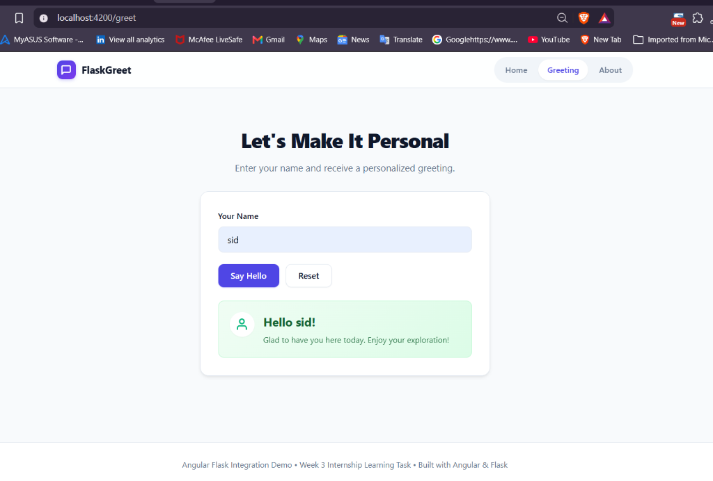
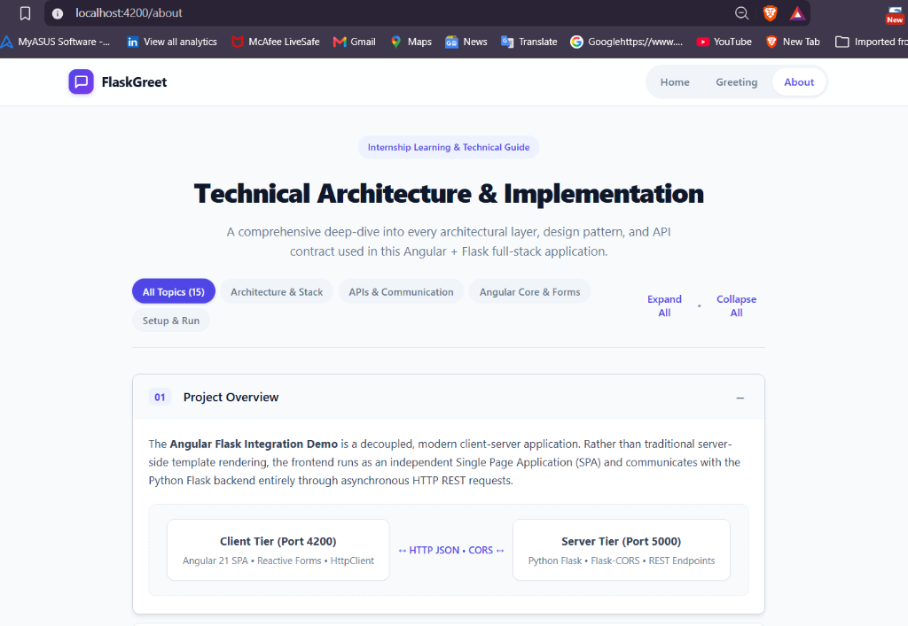
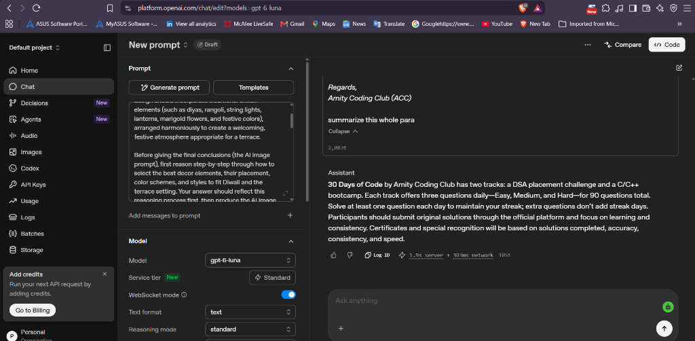

# Project Screenshots

This directory contains actual screenshots captured from the running application and experiments:

---

## 1. Home Page (`home-page.png`)
- **Route:** `/` (`http://localhost:4200`)
- **Description:** Clean, minimal SaaS landing page featuring the hero header, call-to-action buttons ("Get Started", "Learn More"), an interactive live preview card, and three value highlight cards.

---

## 2. Greeting Page (`greeting-page.png`)
- **Route:** `/greet` (`http://localhost:4200/greet`)
- **Description:** Personalized greeting form powered by Angular Reactive Forms. Shows the name input field, action buttons, and the celebratory green response card displaying `"Hello sid!"` returned by the Flask backend (`POST /greet`).

---

## 3. Technical Documentation Page (`about-page.png`)
- **Route:** `/about` (`http://localhost:4200/about`)
- **Description:** Centralized technical documentation hub covering 15 core full-stack topics with interactive category filter pills, expand/collapse toggles, and detailed architectural diagrams.

---

## 4. OpenAI Playground Prompt Engineering (`playground-experiment.png`)
- **Platform:** OpenAI Playground (`platform.openai.com/chat/edit`)
- **Model:** `gpt-6-luna`
- **Description:** Hands-on prompt engineering experiment where a detailed paragraph about the "30 Days of Code by Amity Coding Club" challenge was provided and the model was asked to summarize it (`"summarize this whole para"`), demonstrating zero-shot summarization and key fact extraction.

