# AI Assistant: Full-Stack Web Application

**Internship Training Program — Week 4 Technical Project**  
**Author:** Siddharth Puhan  
**Organization:** WNS  
**Repository Path:** `Week-4/`

---

## 1. Project Title & Overview

The **AI Assistant** is a production-ready, full-stack conversational AI web application engineered during Week 4 of the WNS internship training program. It combines a reactive **Angular 21** standalone frontend with a modular **Python / Flask** REST API backend, backed by **MongoDB** for persistent storage and **Groq Cloud LPU™** for ultra-low latency Large Language Model (LLM) inference.

The application delivers an end-to-end user experience modeled on leading AI chat platforms (such as ChatGPT, Claude, and Gemini), featuring:
- Secure account registration and authentication.
- Cryptographic password hashing (`scrypt`).
- Stateless JSON Web Token (JWT) authorization with server-side token revocation on logout.
- A minimalist, dark-mode conversational UI with responsive design.
- Industrial-grade Markdown rendering supporting syntax-highlighted code blocks, responsive data tables, mathematical expressions, and 1-click clipboard actions.

> **Inference Provider Clarification:**  
> The backend connects to **Groq Cloud** as the primary active AI inference provider using the **OpenAI-compatible Python SDK interface** (`https://api.groq.com/openai/v1`) running the `llama-3.3-70b-versatile` model. Requests are executed against Groq's high-speed inference engine, with architectural provision for fallback to OpenAI.

---

## 2. Project Objectives

The project accomplishes the five core technical objectives outlined in the Week 4 curriculum:

1. **Backend AI Integration:** Expose secure Flask REST API routes to communicate with an external LLM inference provider (Groq) using OpenAI-compatible client libraries.
2. **Frontend Conversational UI:** Build a standalone Angular user interface featuring an empty welcome screen with starter suggestions, an anchored composer, and formatted streaming responses.
3. **JWT Authentication & Session Management:** Implement secure stateless user authentication with JWT, protected route decorators, and server-side token invalidation upon sign-out.
4. **Angular Route Protection & Interceptors:** Safeguard client-side routes via Angular Route Guards (`authGuard`, `guestGuard`) and automatically inject `Authorization: Bearer <token>` headers via functional HTTP interceptors.
5. **MongoDB Persistence & Schema Modeling:** Establish robust database connection handling, user collection schemas, unique email indexing, and automatic TTL index-based revoked token tracking.

---

## 3. Key Features

- **User Registration & Validation:** Client-side reactive form validation (name, email format, password strength >= 6 chars, password confirmation matching) paired with backend database uniqueness constraints.
- **Password Security:** One-way salted `scrypt` hashing via Werkzeug; plain passwords are never stored or logged.
- **JWT Authorization (`HS256`):** Signed 60-minute access tokens containing unique `jti` (JWT ID), subject, and issued-at timestamps.
- **Server-Side Token Revocation:** On logout, the token's `jti` is inserted into MongoDB's `revoked_tokens` collection with an automated TTL expiration index matching token lifetime. Subsequent requests with that token are rejected with `401 Unauthorized`.
- **Protected Minimalist Chatbot Interface:** Centered 850px reading column, collapsible navigation sidebar, and zero diagnostic clutter in the main viewport.
- **Interactive Starter Prompts:** Four 1-click exploration prompts on the welcome screen (*Learn Something*, *Write Code*, *Problem Solving*, *Explore Ideas*) that immediately trigger inference.
- **ChatGPT-Quality Markdown Rendering:** Full support for H1–H4 headers, bold/italic formatting, nested ordered and unordered lists, blockquote callouts, and horizontally scrollable responsive tables.
- **Multi-Language Syntax Highlighting:** Powered by Prism.js covering TypeScript, Python, JavaScript, Java, C, C++, C#, Go, Rust, Bash, SQL, YAML, and Docker.
- **Code Block Chrome:** Code snippets render inside elevated containers with language pills and dedicated **Copy** buttons (with "Copied!" feedback).
- **Assistant Action Toolbar:** Below completed responses, users can **Copy** the raw Markdown, **Regenerate** the prompt against the backend, rate with **Thumbs Up / Down** feedback, or inspect **Token Usage** metrics.
- **Smart Auto-Scroll & Error Resilience:** Automatically scrolls to the newest message without disrupting reading if the user has manually scrolled up. Displays dedicated error cards with **Retry** and **Edit prompt** controls if network or inference failures occur.

---

## 4. Technology Stack

| Layer | Technology / Library | Version | Role in Architecture |
| :--- | :--- | :--- | :--- |
| **Frontend Framework** | Angular | 21.2.0 | Standalone component UI, reactive state, routing |
| **Frontend Language** | TypeScript | 5.9.2 | Type-safe client development |
| **Reactivity** | RxJS | 7.8.0 | Asynchronous event streams, `BehaviorSubject` auth state |
| **Markdown Parser** | Marked | 18.2.0 | AST parsing of LLM responses into HTML |
| **Syntax Highlighter** | Prism.js | 1.30.0 | Syntax highlighting across 13 programming languages |
| **HTML Sanitizer** | DOMPurify | 3.4.17 | Strict XSS sanitization prior to template rendering |
| **Frontend Testing** | Vitest | 4.0.8 | Unit testing for services, components, and Markdown |
| **Backend Framework** | Flask | 3.1.0 | RESTful API server, application factory, routing |
| **Backend Language** | Python | 3.11+ | Backend application logic |
| **CORS Middleware** | Flask-CORS | 5.0.0 | Cross-origin resource sharing for `localhost:4200` |
| **Database Driver** | PyMongo | 4.10.1 | MongoDB connectivity and query execution |
| **Database** | MongoDB Community | 7.0+ / 8.0+ | Document persistence (`users`, `revoked_tokens`) |
| **Authentication** | PyJWT | 2.10.1 | JWT generation, decoding, and signature verification |
| **Password Security** | Werkzeug | 3.1.3 | Salted `scrypt` hashing and verification |
| **AI Client SDK** | OpenAI Python SDK | 1.61.0 | Standard client targeting Groq Cloud OpenAI-compatible endpoint |
| **Inference Provider** | Groq Cloud LPU™ | — | Active inference (`llama-3.3-70b-versatile`) |
| **Backend Testing** | Pytest + Mongomock | 8.3.4 | Offline automated unit and integration tests |

---

## 5. System Architecture

The following diagram illustrates the complete data flow, boundary separation, and communication protocols between the Angular frontend, Flask REST API, MongoDB database, and Groq inference engine:

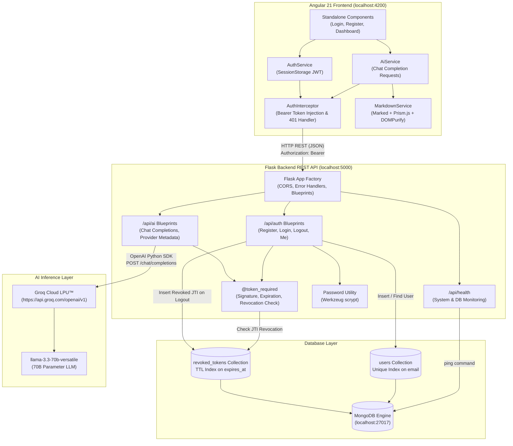

---

## 6. Project Directory Structure

```
Week-4/
├── Documentation/
│   ├── Week_4_Technical_Learning_Report.md         # Technical report markdown source
│   ├── Week_4_Technical_Learning_Report.pdf        # Formatted report PDF
│   └── Week_4_Technical_Learning_and_Research_Report_Final.pdf # Submission document
│
├── Development/
│   ├── backend/                                   # Flask REST API
│   │   ├── app.py                                 # Application factory, blueprints & health
│   │   ├── config.py                              # Environment configuration dataclass
│   │   ├── requirements.txt                       # Production & test dependencies
│   │   ├── .env.example                           # Template environment file
│   │   ├── README.md                              # Backend architectural reference
│   │   │
│   │   ├── ai/                                    # AI provider integration
│   │   │   ├── provider.py                        # OpenAI SDK client configured for Groq
│   │   │   ├── routes.py                          # /api/ai/chat and /api/ai/provider
│   │   │   └── service.py                         # Chat completion handling & usage tracking
│   │   │
│   │   ├── auth/                                  # Authentication module
│   │   │   ├── routes.py                          # /register, /login, /logout, /me
│   │   │   └── services.py                        # JWT issuance, scrypt hashing & @token_required
│   │   │
│   │   ├── database/                              # MongoDB data layer
│   │   │   ├── connection.py                      # MongoClient connection & index creation
│   │   │   └── models.py                          # User and RevokedToken models
│   │   │
│   │   └── tests/                                 # Pytest test suite (17 tests)
│   │       ├── conftest.py                        # Shared fixtures & mongomock database
│   │       ├── test_ai.py                         # AI provider and chat route tests
│   │       ├── test_auth.py                       # Registration, login, logout, revocation tests
│   │       └── test_database.py                   # User model & token model tests
│   │
│   └── frontend/
│       └── ai-assistant/                          # Angular 21 Standalone Application
│           ├── angular.json                       # Angular CLI workspace config & style budgets
│           ├── package.json                       # Node dependencies (Marked, Prism, DOMPurify)
│           ├── tsconfig.json                      # Strict TypeScript compiler options
│           ├── README.md                          # Frontend architecture & guide
│           │
│           ├── src/
│           │   ├── index.html                     # Application shell
│           │   ├── main.ts                        # Bootstrap standalone application
│           │   ├── styles.css                     # Global design tokens & CSS custom properties
│           │   │
│           │   ├── environments/
│           │   │   ├── environment.ts             # Production environment config
│           │   │   └── environment.development.ts # Development API URL (http://localhost:5000/api)
│           │   │
│           │   └── app/
│           │       ├── app.component.ts           # Root router outlet
│           │       ├── app.config.ts              # provideRouter & provideHttpClient config
│           │       ├── app.routes.ts              # Route definitions (/login, /register, /dashboard)
│           │       │
│           │       ├── core/
│           │       │   ├── guards/
│           │       │   │   ├── auth.guard.ts      # Redirects guests to /login
│           │       │   │   └── guest.guard.ts     # Redirects authenticated users to /dashboard
│           │       │   ├── interceptors/
│           │       │   │   └── auth.interceptor.ts# Injects Bearer token; handles 401 logout
│           │       │   ├── models/
│           │       │   │   ├── ai.models.ts       # ChatMessage, ChatResponse, Usage interfaces
│           │       │   │   ├── auth.models.ts     # User, LoginRequest, RegisterRequest interfaces
│           │       │   │   └── health.model.ts    # HealthResponse interface
│           │       │   └── services/
│           │       │       ├── ai.service.ts      # HTTP calls to /api/ai/chat & /health
│           │       │       ├── auth.service.ts    # JWT storage & BehaviorSubject user state
│           │       │       ├── markdown.service.ts# Markdown parsing, Prism highlighting, sanitization
│           │       │       ├── ai.service.spec.ts # AI service unit tests
│           │       │       ├── auth.service.spec.ts # Auth service unit tests
│           │       │       └── markdown.service.spec.ts # Markdown & math unit tests (9 tests)
│           │       │
│           │       └── features/
│           │           ├── auth/
│           │           │   ├── login/             # Login page component
│           │           │   └── register/          # Registration page component
│           │           └── dashboard/             # Main AI chatbot interface
│           │               ├── dashboard.component.ts # Chat logic, copy, regenerate, feedback
│           │               ├── dashboard.component.html # Minimalist chatbot template
│           │               ├── dashboard.component.css  # Dark theme, code blocks & responsive CSS
│           │               └── dashboard.component.spec.ts # Dashboard unit tests (9 tests)
│           │
│           └── dist/                              # Compiled production bundles
│
├── Screenshots/                                   # Verified implementation screenshots
│   ├── 01_mongodb_collections_overview.png
│   ├── 02_mongodb_users_document.png
│   ├── 03_auth_register_page.png
│   ├── 04_auth_login_page.png
│   ├── 05_chatbot_welcome_empty_state.png
│   ├── 06_chatbot_generating_typing_indicator.png
│   ├── 07_chatbot_response_markdown_table.png
│   ├── 08_chatbot_response_code_and_actions.png
│   └── 09_chatbot_multi_turn_conversation.png
│
└── README.md                                      # Main project documentation (this file)
```

---

## 7. Application Workflow

The complete end-to-end user workflow operates as follows:

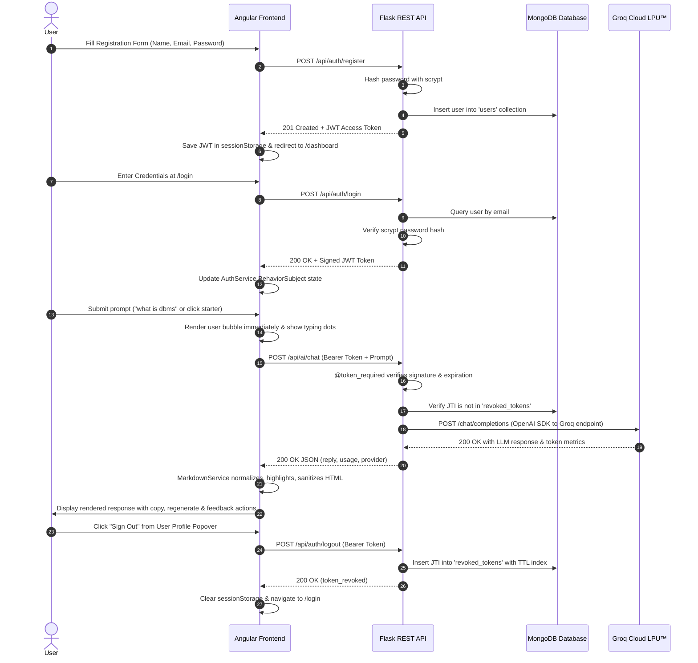

---

## 8. Backend Setup Instructions

### Prerequisites
- Python 3.11 or higher
- Local MongoDB running on port 27017 (or MongoDB Atlas connection string)
- Active Groq API key from [console.groq.com](https://console.groq.com)

### Step-by-Step Setup

1. **Navigate to the backend directory:**
   ```bash
   cd Week-4/Development/backend
   ```

2. **Create and activate a virtual environment:**
   ```bash
   # Windows PowerShell
   python -m venv venv
   .\venv\Scripts\Activate.ps1

   # Linux / macOS
   python3 -m venv venv
   source venv/bin/activate
   ```

3. **Install required packages:**
   ```bash
   pip install -r requirements.txt
   ```

4. **Configure environment variables:**
   Create a `.env` file from `.env.example`:
   ```bash
   copy .env.example .env      # Windows
   cp .env.example .env        # Linux / macOS
   ```
   Open `.env` and set your Groq API key:
   ```ini
   GROQ_API_KEY=gsk_your_actual_key_here
   ```

5. **Start the Flask backend server:**
   ```bash
   python app.py
   ```
   *The server initializes database indexes and listens on `http://127.0.0.1:5000`.*

---

## 9. Frontend Setup Instructions

### Prerequisites
- Node.js v20.x or v22.x
- npm v10.x or v11.x
- Running Flask backend server on `http://127.0.0.1:5000`

### Step-by-Step Setup

1. **Navigate to the frontend directory:**
   ```bash
   cd Week-4/Development/frontend/ai-assistant
   ```

2. **Install frontend dependencies:**
   ```bash
   npm install
   ```

3. **Verify API environment configuration:**
   Verify `src/environments/environment.development.ts` points to the Flask server:
   ```typescript
   export const environment = {
     production: false,
     apiUrl: 'http://localhost:5000/api'
   };
   ```

4. **Start the Angular development server:**
   ```bash
   npm start
   ```
   *The Angular CLI compiles bundles and starts the local server at `http://localhost:4200`.*

5. **Open in browser:**  
   Navigate to **`http://localhost:4200`**. Unauthenticated visitors are automatically routed to `/login`.

---

## 10. Environment Variable Configuration

The backend reads configuration settings from `Week-4/Development/backend/.env`. A clean template is provided in `.env.example`:

| Environment Variable | Required | Default Value | Description |
| :--- | :---: | :--- | :--- |
| `FLASK_ENV` | No | `development` | Flask runtime mode (`development` or `production`) |
| `PORT` | No | `5000` | Port for Flask web server |
| `SECRET_KEY` | Yes | `dev-secret-key-change-in-production` | Secret key for Flask application sessions |
| `JWT_SECRET_KEY` | Yes | `jwt-secret-key-change-in-production` | Secret key used to sign and verify JWT tokens (`HS256`) |
| `JWT_ACCESS_TOKEN_EXPIRES_MINUTES` | No | `60` | Lifetime of issued JWT tokens in minutes |
| `MONGODB_URI` | Yes | `mongodb://localhost:27017` | MongoDB connection URI string |
| `MONGODB_DATABASE` | Yes | `week4_ai_assistant` | Target database name inside MongoDB |
| `AI_PROVIDER` | Yes | `groq` | Active AI provider (`groq` or `openai`) |
| `GROQ_API_KEY` | Yes | `gsk_...` | Groq Cloud API authentication key |
| `GROQ_MODEL` | No | `llama-3.3-70b-versatile` | Groq LLM model identifier |
| `GROQ_BASE_URL` | No | `https://api.groq.com/openai/v1` | OpenAI-compatible base URL for Groq API |
| `OPENAI_API_KEY` | No | `sk-...` | Optional OpenAI key if switching providers |
| `OPENAI_MODEL` | No | `gpt-4o-mini` | Optional OpenAI model identifier |
| `OPENAI_BASE_URL` | No | `https://api.openai.com/v1` | Optional OpenAI base URL |
| `FRONTEND_ORIGIN` | No | `http://localhost:4200` | Allowed CORS origin for Angular client |

---

## 11. API Endpoint Documentation

All backend API routes are prefixed with `/api`. Authenticated endpoints require an `Authorization: Bearer <token>` header.

### Central Health Check

#### `GET /api/health`
Checks backend responsiveness, executes a `ping` command against MongoDB, and reports the active AI provider.
- **Authentication:** None (Public)
- **Response `200 OK`:**
  ```json
  {
    "active_ai_provider": "groq",
    "database": "connected",
    "environment": "development",
    "service": "AI Assistant Backend",
    "status": "healthy"
  }
  ```

---

### Authentication Module (`/api/auth`)

#### `POST /api/auth/register`
Validates registration parameters, ensures email uniqueness, hashes the password via `scrypt`, stores the user in MongoDB, and issues a signed JWT.
- **Authentication:** None (Public)
- **Request Body:**
  ```json
  {
    "name": "Siddharth Puhan",
    "email": "siddharth@example.com",
    "password": "SecurePassword123"
  }
  ```
- **Response `201 Created`:**
  ```json
  {
    "message": "User registered successfully",
    "token": "eyJhbGciOiJIUzI1NiIsInR5cCI6IkpXVCJ9...",
    "user": {
      "id": "67301f4c56111290e34683d6",
      "name": "Siddharth Puhan",
      "email": "siddharth@example.com",
      "created_at": "2026-11-10T07:41:58.820000+00:00"
    }
  }
  ```
- **Error Codes:** `400 Bad Request` (validation errors), `409 Conflict` (email already exists).

#### `POST /api/auth/login`
Validates user credentials against the stored `scrypt` hash and issues a new JWT access token.
- **Authentication:** None (Public)
- **Request Body:**
  ```json
  {
    "email": "siddharth@example.com",
    "password": "SecurePassword123"
  }
  ```
- **Response `200 OK`:**
  ```json
  {
    "message": "Login successful",
    "token": "eyJhbGciOiJIUzI1NiIsInR5cCI6IkpXVCJ9...",
    "user": {
      "id": "67301f4c56111290e34683d6",
      "name": "Siddharth Puhan",
      "email": "siddharth@example.com"
    }
  }
  ```
- **Error Codes:** `401 Unauthorized` (invalid credentials).

#### `POST /api/auth/logout`
Revokes the current JWT token by extracting its `jti` claim and inserting it into MongoDB's `revoked_tokens` collection with an automated TTL expiration date.
- **Authentication:** Required (`Bearer <token>`)
- **Response `200 OK`:**
  ```json
  {
    "message": "Successfully logged out",
    "status": "token_revoked"
  }
  ```
- **Error Codes:** `401 Unauthorized` (missing, invalid, or already revoked token).

#### `GET /api/auth/me`
Retrieves the sanitized user profile for the token holder.
- **Authentication:** Required (`Bearer <token>`)
- **Response `200 OK`:**
  ```json
  {
    "user": {
      "id": "67301f4c56111290e34683d6",
      "name": "Siddharth Puhan",
      "email": "siddharth@example.com",
      "created_at": "2026-11-10T07:41:58.820000+00:00"
    }
  }
  ```

---

### AI Assistant Module (`/api/ai`)

#### `POST /api/ai/chat`
Validates the prompt, verifies the token against revocation status, dispatches the prompt to Groq Cloud via the OpenAI SDK interface, and returns the response with token usage telemetry.
- **Authentication:** Required (`Bearer <token>`)
- **Request Body:**
  ```json
  {
    "prompt": "Explain REST API architecture with a Node.js example. Include a comparison table and code example.",
    "system_message": "You are a helpful and concise AI assistant."
  }
  ```
- **Response `200 OK`:**
  ```json
  {
    "data": {
      "model": "llama-3.3-70b-versatile",
      "provider": "groq",
      "reply": "### 1. What is a REST API?\n\nREST (Representational State Transfer) is an architectural style...\n\n| Constraint | What it means |\n|---|---|\n| Stateless | Every request contains all required info |\n\n```javascript\nconst express = require('express');\nconst app = express();\n```",
      "usage": {
        "prompt_tokens": 42,
        "completion_tokens": 315,
        "total_tokens": 357
      }
    },
    "success": true,
    "user_id": "67301f4c56111290e34683d6"
  }
  ```
- **Error Codes:** `400 Bad Request` (missing prompt or > 4000 characters), `401 Unauthorized` (invalid/revoked token), `502 Bad Gateway` (upstream provider error).

#### `GET /api/ai/provider`
Returns metadata regarding available AI providers, base URLs, and active model configuration without leaking secrets.
- **Authentication:** Required (`Bearer <token>`)
- **Response `200 OK`:**
  ```json
  {
    "active_model": "llama-3.3-70b-versatile",
    "active_provider": "groq",
    "providers": {
      "groq": {
        "base_url": "https://api.groq.com/openai/v1",
        "default_model": "llama-3.3-70b-versatile",
        "is_configured": true,
        "name": "groq"
      },
      "openai": {
        "base_url": "https://api.openai.com/v1",
        "default_model": "gpt-4o-mini",
        "is_configured": false,
        "name": "openai"
      }
    }
  }
  ```

---

## 12. Testing Instructions & Verified Results

### Automated Backend Tests (Pytest)
The backend test suite executes 100% offline using `mongomock` and mocked AI clients, guaranteeing zero credit consumption during test runs.

```bash
cd Week-4/Development/backend
pytest tests/ -v
```

**Verified Test Output (17 Passed):**
```text
tests/test_ai.py::test_groq_provider_initialization PASSED                   [  5%]
tests/test_ai.py::test_openai_provider_initialization PASSED                 [ 11%]
tests/test_ai.py::test_invalid_provider_fallback PASSED                      [ 17%]
tests/test_ai.py::test_chat_completion_success_mocked PASSED                 [ 23%]
tests/test_ai.py::test_chat_validation_empty_prompt PASSED                  [ 29%]
tests/test_ai.py::test_chat_validation_oversized_prompt PASSED              [ 35%]
tests/test_ai.py::test_ai_provider_info_endpoint PASSED                     [ 41%]
tests/test_auth.py::test_health_check_endpoint PASSED                        [ 47%]
tests/test_auth.py::test_register_success PASSED                             [ 52%]
tests/test_auth.py::test_register_validation_errors PASSED                   [ 58%]
tests/test_auth.py::test_register_duplicate_email PASSED                     [ 64%]
tests/test_auth.py::test_login_success_and_failure PASSED                    [ 70%]
tests/test_auth.py::test_protected_me_endpoint PASSED                       [ 76%]
tests/test_auth.py::test_logout_and_token_revocation PASSED                 [ 82%]
tests/test_database.py::test_user_creation_and_retrieval PASSED             [ 88%]
tests/test_database.py::test_user_to_dict_sanitization PASSED               [ 94%]
tests/test_database.py::test_revoked_token_management PASSED                [100%]

============================== 17 passed in 0.85s ==============================
```

---

### Automated Frontend Tests (Vitest)
The frontend test suite validates services, interceptors, Markdown AST rendering, syntax highlighting, and conversational actions.

```bash
cd Week-4/Development/frontend/ai-assistant
npx ng test --watch=false
```

**Verified Test Output (27 Passed across 5 Suites):**
```text
 ✓  ai-assistant  src/app/core/services/ai.service.spec.ts (4 tests)
 ✓  ai-assistant  src/app/core/services/auth.service.spec.ts (4 tests)
 ✓  ai-assistant  src/app/app.component.spec.ts (1 test)
 ✓  ai-assistant  src/app/core/services/markdown.service.spec.ts (9 tests)
 ✓  ai-assistant  src/app/features/dashboard/dashboard.component.spec.ts (9 tests)

 Test Files  5 passed (5)
      Tests  27 passed (27)
   Duration  14.71s
```

---

### Production Build Verification
```bash
cd Week-4/Development/frontend/ai-assistant
npm run build
```

**Verified Build Output (Exit Code 0, Zero Errors, Zero Warnings):**
```text
Application bundle generation complete. [9.835 seconds]
Initial chunk files | Names               |  Raw size | Estimated transfer size
chunk-Q2OAV3KC.js   | -                   | 258.35 kB |                70.00 kB
styles-DRRVXB4R.css | styles              |   2.40 kB |               861 bytes
main-MCMZW2L6.js    | main                |   1.44 kB |               696 bytes
                    | Initial total       | 262.19 kB |                71.55 kB

Lazy chunk files    | Names               |  Raw size | Estimated transfer size
chunk-C6LQQXTK.js   | dashboard-component | 197.21 kB |                53.66 kB
chunk-VLYZ7DQD.js   | -                   |  37.03 kB |                 7.99 kB
chunk-ZHUWLCH3.js   | register-component  |  13.50 kB |                 3.45 kB
chunk-5Q6KIKAB.js   | login-component     |  11.07 kB |                 3.25 kB

Output location: dist/ai-assistant
```

---

## 13. Screenshots Section

All screenshots below represent actual execution captures of the implemented system stored in [`Screenshots/`](Screenshots/).

### Database & MongoDB Persistence

#### MongoDB Database & Collections Overview
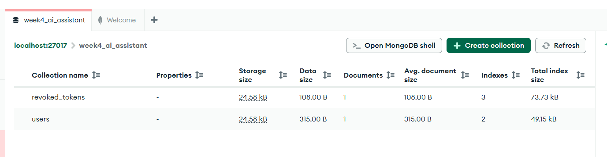
*Figure 1: MongoDB Compass connected to `localhost:27017` displaying the `week4_ai_assistant` database with both the `users` collection and the `revoked_tokens` collection with index configurations.*

#### User Document & Salted Password Hash
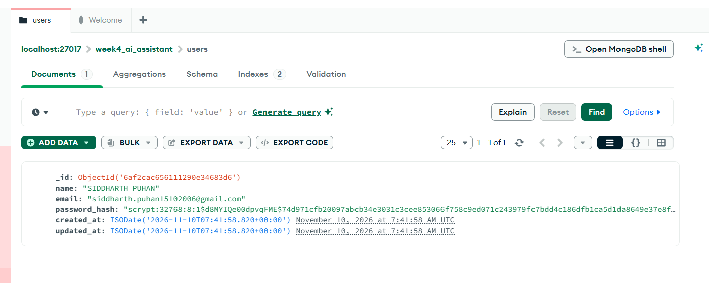
*Figure 2: MongoDB document representation showing the user record with the salted `scrypt:32768:8:1` password hash, generated `_id`, and UTC timestamps.*  
*(Note: Displayed during local development verification; personal credentials should not be exposed in public repositories).*

---

### Authentication Interfaces

#### User Account Registration (`/register`)
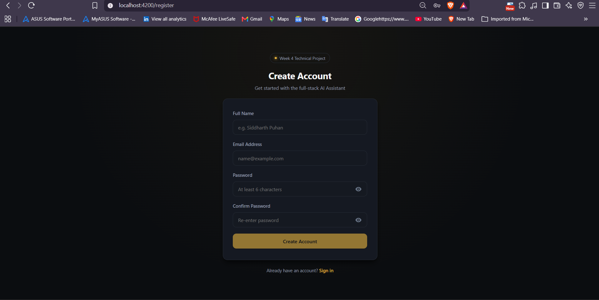
*Figure 3: Angular reactive registration interface with client-side form controls, password strength requirement, and password confirmation matching.*

#### User Login Interface (`/login`)
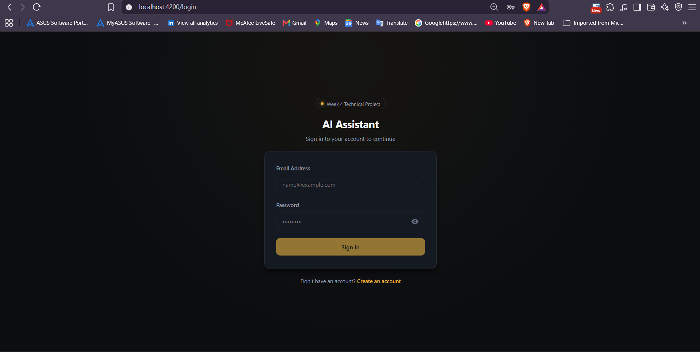
*Figure 4: Secure authentication page with password visibility toggle, clear field placeholders, and navigation to the registration flow.*

---

### Dashboard & Conversational UI

#### Minimalist AI Assistant Welcome Screen
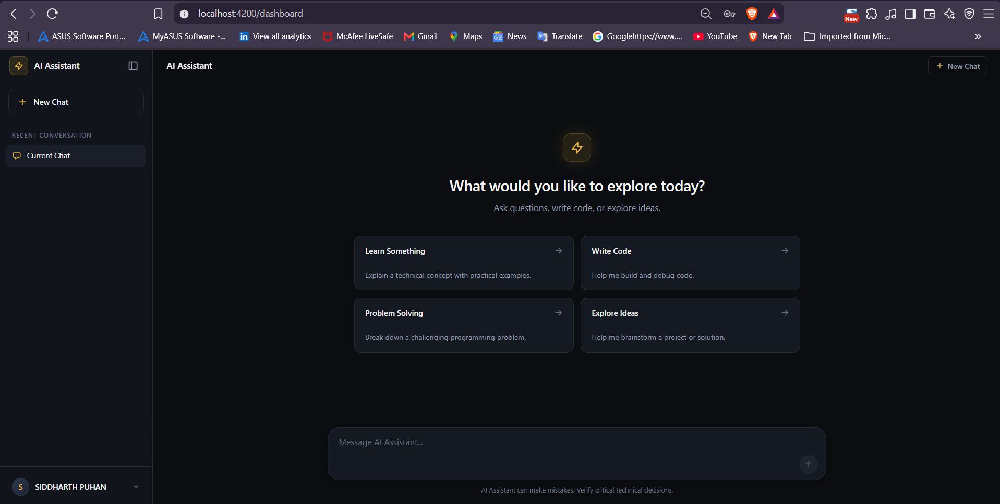
*Figure 5: Polished empty state inspired by ChatGPT and Claude, featuring the golden spark badge, welcome heading, 4 interactive starter suggestion cards, collapsible sidebar, and bottom composer.*

#### Live Generation & Typing Indicator
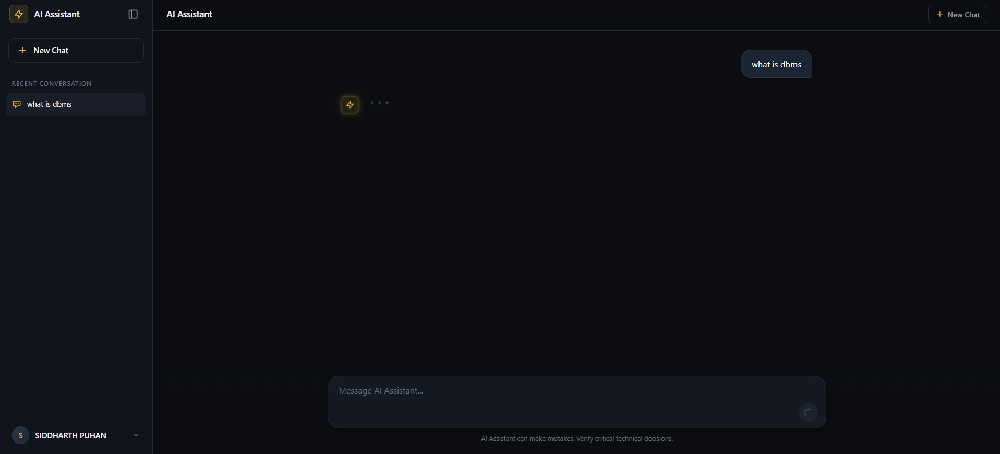
*Figure 6: Live inference state showing the pulsing three-dot typing indicator, disabled send button with spinner, and locked composer preventing duplicate requests.*

#### Rendered Markdown Response & Comparison Table
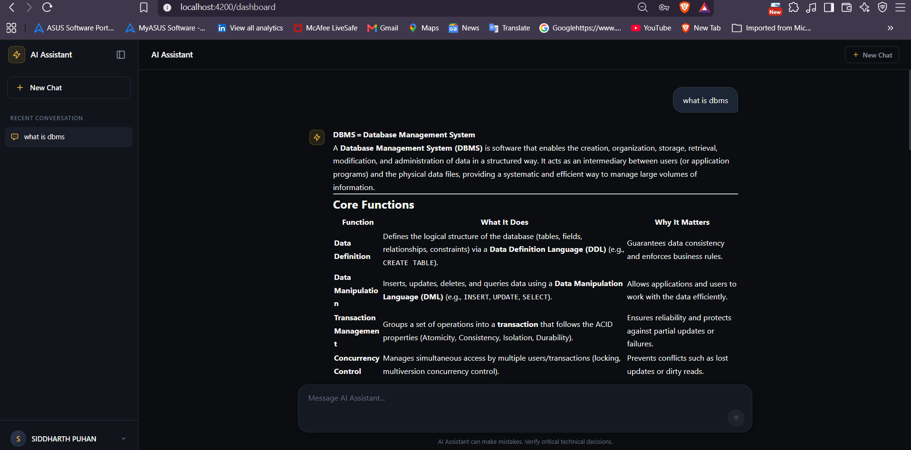
*Figure 7: Completed AI response for "what is dbms" rendered with clean typography, section headings, bold terms, and a responsive comparison table.*

#### Syntax-Highlighted Code Block & Assistant Toolbar
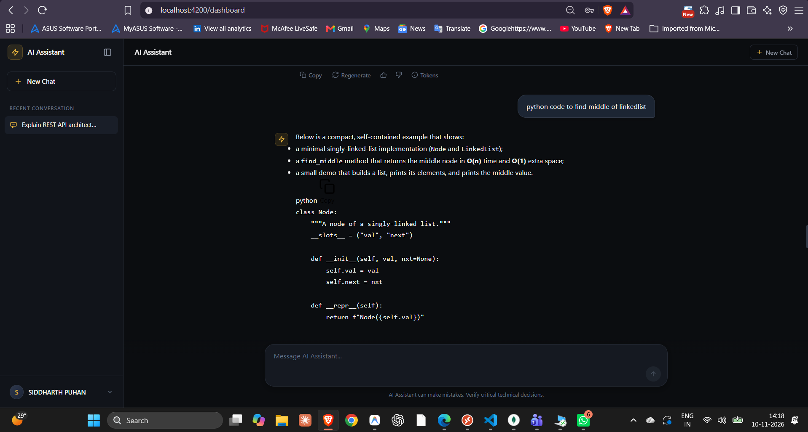
*Figure 8: Rendered Python code block showing language label (`python`), code-only copy button, and the compact assistant action toolbar (Copy, Regenerate, Thumbs up/down, and expandable Tokens disclosure).*

#### Multi-Turn Conversation View
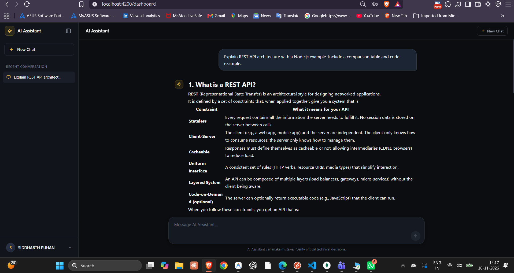
*Figure 9: Conversational chat flow displaying user message bubbles (`#1C2533`), seamless assistant markdown responses, and active sidebar conversation navigation.*

---

## 14. Security Considerations

1. **Password Hashing:** Passwords are never stored in plaintext. They are salted and hashed using Werkzeug's `scrypt` implementation with CPU/memory cost parameters (`scrypt:32768:8:1`).
2. **Server-Side Token Revocation:** JWTs contain a cryptographically unique `jti` claim. Upon logout, the `jti` is stored in MongoDB's `revoked_tokens` collection with an automated TTL expiration index. Even if an attacker possesses the token string, it is rejected by the `@token_required` decorator.
3. **SessionStorage Token Storage:** Tokens are held in browser `sessionStorage`, meaning tokens are immediately destroyed when the browser tab is closed, minimizing XSS persistence.
4. **HTML Sanitization (DOMPurify):** LLM Markdown outputs are parsed to HTML and sanitized through DOMPurify with an explicit tag and attribute whitelist before binding via Angular's `DomSanitizer`, mitigating script injection and malicious URI schemes (`javascript:`).
5. **No Secret Leakage:** The client never receives API keys, secrets, or internal stack traces. The `/api/ai/provider` endpoint returns boolean status flags (`is_configured: true`) without exposing the actual key.
6. **CORS Isolation:** The Flask backend restricts cross-origin access exclusively to `http://localhost:4200` via Flask-CORS.

---

## 15. Limitations & Future Improvements

- **Conversation Session Persistence:** Chat messages currently persist within the Angular component's reactive state during an active browser session. Future work could introduce a dedicated `conversations` and `messages` collection in MongoDB to support multi-device persistent history.
- **Token Streaming via Server-Sent Events (SSE):** The current implementation returns completed completions upon full response generation. Implementing an SSE endpoint (`text/event-stream`) would enable word-by-word real-time token streaming.
- **Dynamic Provider Switching from UI:** While the backend supports both Groq and OpenAI through the OpenAI Python SDK, runtime switching currently occurs via environment configuration (`AI_PROVIDER=groq|openai`). A model selector dropdown could allow authenticated users to switch models on the fly.
